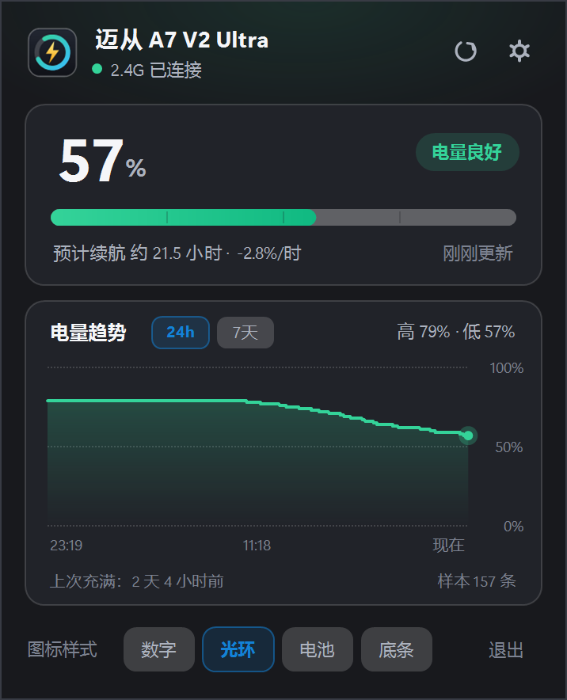
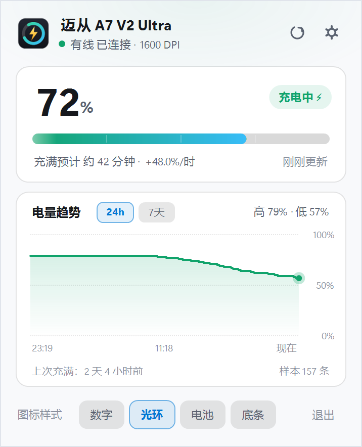
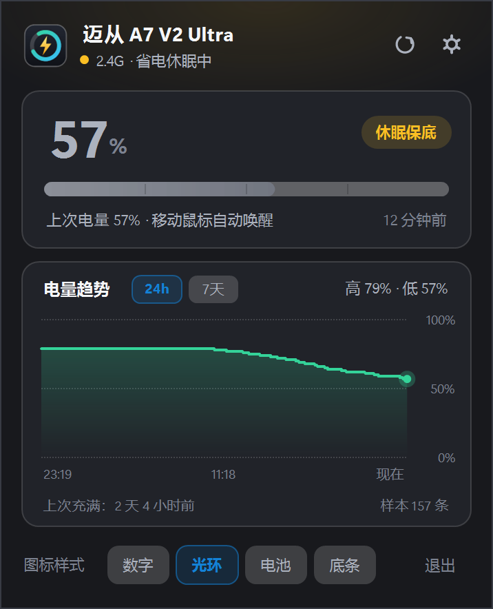
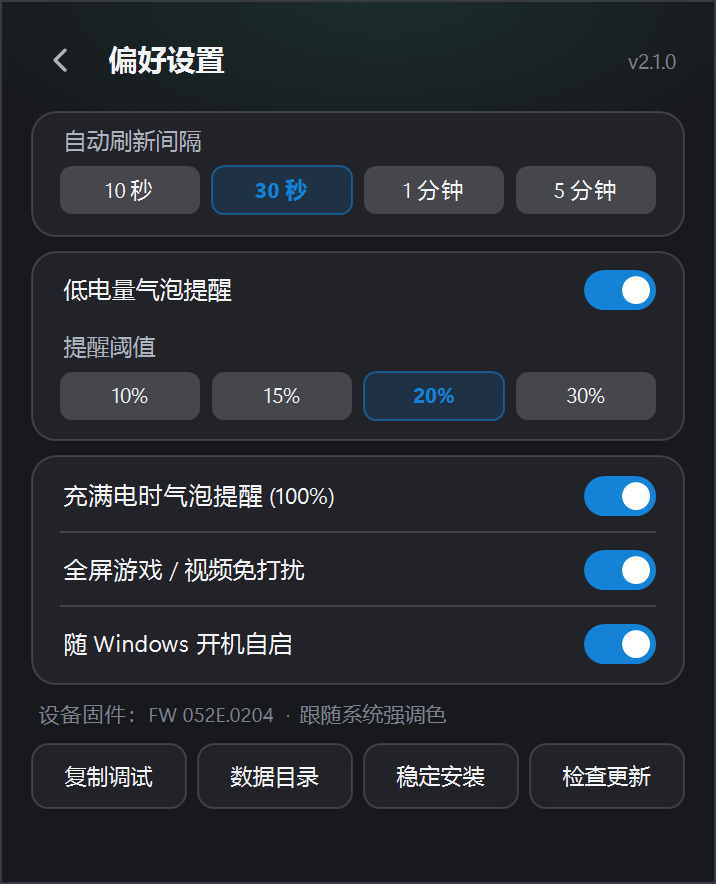
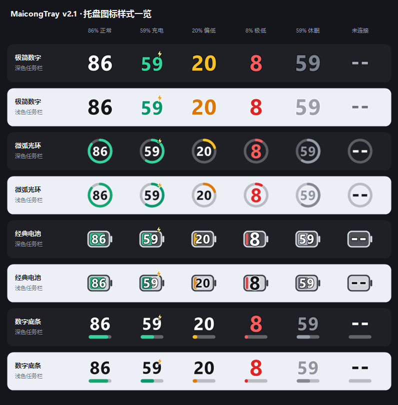

<div align="center">

# ⚡ MaicongTray — 迈从鼠标 Windows 11 任务栏电量显示工具

**轻巧、零依赖、原生 Win11 亚克力毛玻璃质感的迈从（MCHOSE）无线鼠标电量托盘工具（无需常驻 MCHOSE HUB）**

*Lightweight, zero-dependency (~122 KB single-file) Windows 10/11 system tray battery indicator & Acrylic flyout dashboard for **MCHOSE (迈从) A7 V2 Ultra** wireless gaming mice — no MCHOSE HUB required.*

[](https://github.com/nzdtam0010/MaicongTray/releases/latest)
[](https://github.com/nzdtam0010/MaicongTray/releases)
[-512BD4?style=flat-square)](https://github.com/nzdtam0010/MaicongTray)
[](LICENSE)

单文件约 **122 KB** · 无需 Python 或额外运行库 · 告别 Electron 驱动内存占用

[立即下载最新版 (Releases)](https://github.com/nzdtam0010/MaicongTray/releases/latest) · [中文发布博客](https://junhuas.net/post/maicong-a7-v2-ultra-tray-v2-1-0) · [功能亮点](#核心特性--key-features) · [常见问题](#常见问题-faq) · [从源码编译](#从源码编译)

</div>

---

## 界面预览 / Screenshots

<table>
  <tr>
    <td align="center" width="50%">
      <br />
      <sub><b>深色主题 · 24h / 7天 电量趋势曲线与续航估算</b></sub>
    </td>
    <td align="center" width="50%">
      <br />
      <sub><b>浅色主题 · 充电流光动效与预计充满耗时</b></sub>
    </td>
  </tr>
  <tr>
    <td align="center" width="50%">
      <br />
      <sub><b>鼠标休眠保底 · 柔灰保留上次电量，不误报离线</b></sub>
    </td>
    <td align="center" width="50%">
      <br />
      <sub><b>内置偏好设置 · 全屏免打扰 / 固件版本 / 一键管理</b></sub>
    </td>
  </tr>
</table>

### 4 套高分托盘图标样式（自动适配深浅色任务栏与休眠态）

<p align="center">
  
</p>

---

## 为什么选择 MaicongTray？

| 对比项 | MaicongTray v2.1.0 | 官方 MCHOSE HUB |
| --- | --- | --- |
| 任务栏实时电量显示 | 原生支持（4 套样式可选） | 需打开主界面或悬浮窗查看 |
| 体积与运行依赖 | **单文件 ~122 KB**，零依赖（Windows 内置 .NET 4.x） | 完整安装版驱动套件 |
| 电量历史与续航估算 | 内置 **7 天趋势曲线** + 续航/充满回归估算 | 仅当前即时电量 |
| 游戏免打扰 | 支持独占/无边框全屏自动静默提醒 | 无 |
| 鼠标休眠体验 | 柔灰保留上次电量，不误报离线 | 休眠后不可读取 |

---

## 核心特性 / Key Features

- **原生 Win11 亚克力毛玻璃悬浮面板（左键 / 右键统一界面）**
  - 彻底移除老旧 Win32 右键菜单，点击托盘左键或右键均平滑呼出同一套现代悬浮面板。
  - 调用 Windows 11 硬件级 `Acrylic` 毛玻璃材质（`DWMWA_SYSTEMBACKDROP_TYPE` + 32bpp 预乘 Alpha 合成；Windows 10 自动回退为纯净不透明表面）。
  - 通过 `Shell_NotifyIconGetRect` 精准居中锚定托盘图标正上方，附带丝滑 `ease-out cubic` 上滑与淡入动画。
  - 自动读取并适配 Windows 系统深浅主题与 DWM 强调色，支持 `Per-Monitor DPI Awareness V2`，高分屏文字与线条锐利不发虚。
- **4 套精选高分托盘图标（4 Crisp Tray Icon Styles）**
  - **极简数字 / 微弧光环 / 经典电池 / 数字底条**，面板底部一键即时切换，自动区分深浅任务栏、充电呼吸闪电、低电警示色与休眠柔灰态。
- **游戏与日常深度优化**
  - **全屏游戏 / 视频免打扰（Fullscreen Game DND）**：同时监测独占全屏（`SHQueryUserNotificationState`）与无边框全屏窗口，全屏期间自动暂缓气泡提醒，退出全屏后自动补发。
  - **休眠保底显示（Sleep Preservation）**：鼠标进入无线省电休眠时不再骤变为 `--`，柔灰保留上次有效电量并标注「休眠保底」，轻移鼠标即刻恢复。
  - **7 天电量历史曲线 & 续航回归估算（7-Day Sparkline & ETA）**：本地保存最近 7 天采样（`%APPDATA%\MaicongTray\history.csv`），支持 `24h` / `7天` 一键切换、悬停逐点查看精确时间与电量，并自动展示耗电速率与「上次充满」耗时。
  - **设备固件版本号解析**：自动解析协议报文中的固件版本并展示在偏好设置页。
- **真正轻量与省心**
  - **单文件零依赖**：仅依赖 Windows 系统自带的 `.NET Framework 4.x`，无后台 Electron/WebView 内存开销。
  - 支持接收器热插拔即时重连（`WM_DEVICECHANGE`）、睡眠唤醒自动刷新（`WM_POWERBROADCAST`）、Explorer 重启自动重建托盘图标（`TaskbarCreated`）、一键开机自启、稳定副本安装与 GitHub Releases 自动更新检测。

---

## 安装与使用 / Quick Start

1. 前往 [**Releases**](https://github.com/nzdtam0010/MaicongTray/releases/latest) 页面下载 `MaicongTray.exe`（单文件，双击即用）。
2. 在任务栏托盘区即可看到实时电量图标，**左键或右键点击图标**打开悬浮面板：
   - 底部一键切换 4 套图标样式，或点击 **退出** 关闭程序。
   - 点击右上角 **⚙ 齿轮** 进入偏好设置：配置刷新间隔、低电量提醒阈值、充满提醒、全屏免打扰、开机自启与稳定安装（复制到 `%LOCALAPPDATA%\MaicongTray` 并自动指向自启）。
3. 历史电量曲线与日志保存在 `%APPDATA%\MaicongTray`，不会在 `exe` 所在目录留下任何散落文件。

---

## 常见问题 (FAQ)

- **不用打开官方 MCHOSE HUB 也能显示迈从鼠标电量吗？**  
  可以。MaicongTray 直接通过 Windows 原生 HID 接口与 2.4G 接收器 / USB 有线通道通信，无需安装或后台运行 MCHOSE HUB。
- **支持哪些迈从（MCHOSE）鼠标型号？**  
  主要基于 **迈从 A7 V2 Ultra**（2.4G 接收器 `VID:PID 3837:100B` 与 USB 有线模式）开发与实测；代码同时包含经典 `0x11/0x06` 与 V2 `0x4D/0x0900` 协议路径，兼容同协议的迈从无线鼠标系列（如 A7 / L7 / M7 / AX5 / K7 等）。可运行 `MaicongCheck.exe` 快速验证。
- **Windows Defender / SmartScreen 提示未签名怎么办？**  
  个人开源项目暂未购买商业代码签名证书，下载后可核对 Release 页提供的 `SHA256SUMS.txt`，或直接拉取源码用 `build.cmd` 本地编译。

---

## 从源码编译 / Build from Source

无需安装 Visual Studio 或 .NET SDK，直接调用 Windows 自带的 `.NET Framework 4.x` 编译器（`csc.exe`）：

```cmd
git clone https://github.com/nzdtam0010/MaicongTray.git
cd MaicongTray
build.cmd
```

编译产物输出至 `dist/`：
- `dist\MaicongTray.exe` — 托盘主程序
- `dist\MaicongCheck.exe` — 命令行 HID 诊断与预览图生成工具

### 命令行诊断工具用法

```cmd
dist\MaicongCheck.exe                     :: 读取实时电量、固件版本与完整协议日志
dist\MaicongCheck.exe --icons             :: 生成 4 套图标深浅色预览图
dist\MaicongCheck.exe --flyout-preview    :: 生成悬浮面板预览图（深/浅/休眠/设置页）
dist\MaicongCheck.exe --makeico           :: 重新生成 Fluent 风格 icon.ico
dist\MaicongCheck.exe --dpi               :: 探测当前固件是否支持 DPI 回读
```

---

## 项目结构

```text
MaicongTray/
├── src/
│   ├── Models/BatteryModels.cs       # 电量状态、图标样式与设置模型
│   ├── Protocol/
│   │   ├── NativeHid.cs              # Win32 HID 协议（经典 0x11/0x06、E2 推送、DPI、V2 备用）
│   │   ├── BatteryReader.cs          # 命令行单次读取器
│   │   └── DeviceWatcher.cs          # 常驻异步监听线程（无 CancelIoEx 轮询开销）
│   ├── Core/
│   │   ├── BatteryHistory.cs         # 7 天 CSV 历史、线性回归续航估算与上次充满追踪
│   │   ├── ThemeHelper.cs            # Win11 Acrylic、系统强调色、深浅主题与 DPI 工具
│   │   ├── FullscreenDetector.cs     # 独占/无边框全屏游戏免打扰检测
│   │   ├── SettingsStore.cs          # 注册表配置、开机自启与稳定副本安装
│   │   ├── UpdateChecker.cs          # GitHub Releases TLS 1.2 自动更新检测
│   │   └── ErrorLog.cs               # 崩溃与自启日志
│   ├── Rendering/
│   │   └── IconRenderer.cs           # 4 套高分托盘图标 + Fluent 应用图标渲染器
│   ├── UI/
│   │   └── BatteryFlyoutForm.cs      # Win11 亚克力悬浮面板（趋势图 + 内置设置）
│   ├── TrayApp.cs                    # 托盘主控、精准锚定与系统消息响应
│   └── Program.cs                    # 单实例入口与 CLI 诊断模式
├── .github/workflows/release.yml     # GitHub Actions 自动编译与发布工作流
├── docs/images/                      # README 预览截图
├── build.cmd                         # 零依赖一键编译脚本
├── icon.ico                          # 多分辨率 Fluent 应用图标
└── LICENSE                           # MIT 开源协议
```

---

## HID 协议说明

设备接口：迈从接收器 `VID:PID 3837:100B`，vendor 集合 `FF01:0001`（65 字节报文）。

1. **取反查询**：发送 Feature Report `0x11`，数据为 `0x06 ^ 0xFF` 后全 `0xFF` 填充。
2. **E2 主动推送**（Input Report `0x13`，取反后）：`[E2][connectMode][?][charge][battery]...`
3. **特征报文回读**（明文/取反相位交替，偏移 2 起）：`vid(2) pid(2) fwVersion(4) flags(1) batteryLevel(1) chargeStatus(1)`，其中 `flags & 0x07` 表示连接模式（`0=有线`、`1=2.4G`、`2/3=蓝牙`）。

协议实现参考了开源社区 [`mitsimi/mchose-tray`](https://github.com/mitsimi/mchose-tray) 与 [`Rapou7/offline-mchose`](https://github.com/Rapou7/offline-mchose) 的逆向成果，特此致谢。

---

## License

本项目基于 [MIT License](LICENSE) 开源。本项目为个人制作的第三方工具，与迈从（MCHOSE）官方无隶属关系。详情发布记录亦可参考 [作者博客文章](https://junhuas.net/post/maicong-a7-v2-ultra-tray-v2-1-0)。
